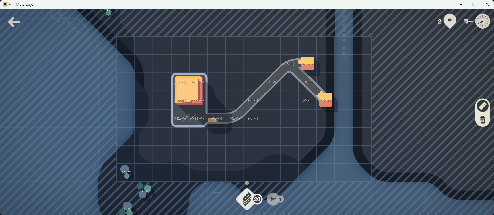

# Moretoways

BepInEx plugin for observing and controlling a running Mini Motorways game
through a local HTTP API. Road and facility edits, motorway creation, weekly
upgrade selection, active-game restart, and pause/resume are implemented.
Simulation-time decision boundaries and final action receipts are still under development.

## Build

The project currently references the local Mono game and BepInEx assemblies in
`Moretoways.csproj`. Update those paths if the game is installed elsewhere.
Override `OutputPath` to build without writing directly into the game directory:

```powershell
dotnet msbuild Moretoways.csproj /t:Build /p:Configuration=Debug /p:OutputPath=bin\Debug\
```

Copy the built `Moretoways.dll` and `Newtonsoft.Json.dll` into the game's
`BepInEx/plugins` directory if Newtonsoft.Json is not already available there.

## Grid visibility shortcut

Press `Ctrl+M` during a game to toggle always-visible world grid mode. Either
the left or right Ctrl key works. When enabled, the grid remains visible after
the mouse button is released, and each visible tile is labelled with its
`(x,y)` coordinate in semi-transparent text. The labels follow the tiles while
the camera moves or zooms. Press `Ctrl+M` again to hide the labels, disable the
mode immediately, and restore the game's original press-to-show,
release-to-hide behavior.



The toggle is not saved to a configuration file. It defaults to disabled each
time Mini Motorways starts.

## Read API

See the [complete API reference](docs/api.md) for all implemented paths,
parameters, response fields, status codes, and request lifecycle rules.

The listener accepts requests on `localhost:9000`.
Each request is passed to Unity's main thread; the server
thread never reads live Unity or game objects.
Browser clients may use cross-origin `GET` and `POST` requests; the listener
answers `OPTIONS` preflight requests and exposes the corresponding CORS headers.

| Endpoint | Response |
| --- | --- |
| `GET /snapshot` | Full game state snapshot. `/` is an alias. |
| `GET /tiles` | Tiles from a single snapshot. |
| `GET /tiles/count` | Tile count. |
| `GET /destinations` | One entry per destination building, including `groupIndex`, demand state, footprint, and carpark coordinates. |
| `GET /game/status` | Phase, score, clock, available resources, and readiness flags. |
| `GET /game/upgrades` | Pending weekly upgrade choices and whether the selection screen is ready. |
| `GET /game/maps` | Available map identifiers (`cityName`) and display names. |
| `GET /requests?id=<requestId>` | Processing status and original HTTP result of a state-changing request. Does not confirm that a scheduled simulation edit executed. |
| `POST /actions/road` | Add one road connection from `(x, y)` in `direction`. |
| `POST /actions/clear` | Clear roads or a specified facility type on tile `(x, y)`, respecting permanence rules. |
| `POST /actions/traffic-light` | Add a traffic light on a tile. |
| `POST /actions/roundabout` | Add a roundabout on a tile. |
| `POST /actions/motorway` | Add a motorway between two endpoint tiles. |
| `POST /actions/upgrade` | Select a pending weekly upgrade option. |
| `POST /actions/noop` | Explicitly record a decision without an edit. |
| `POST /game/restart` | Restart the current map from an active or game-over game, optionally choosing a seed. |
| `POST /game/new` | Start a new normal game with a chosen map, seed, and optional paused state. |
| `POST /game/pause` | Pause simulation while leaving the game board available for observation. |
| `POST /game/resume` | Resume simulation at normal speed. |

`/snapshot` includes a `snapshotId` that starts at 1 for each new game and
increases monotonically until the next game starts, plus a UTC timestamp,
phase (`menu`, `playing`, or `gameOver`), `map` (`cityName`), time scale mode, score, clock, available upgrades, and
`editCommandsExecuted` (a diagnostic count of simulation edit commands), and
tile, vehicle, and motorway lists. Each tile contains its coordinates, content type and type-specific
data, directional road states, and traffic light / roundabout information.
Destination buildings occupy multiple tiles; tiles sharing a `buildingId`
represent one building. `/destinations` returns each building once.
`groupIndex` is the stable identifier to use for matching houses and
destinations; its display color may vary by city.

Each destination also includes a nested `demand` object. `unassigned` counts
pins that have not selected a vehicle yet, while `assigned` counts pins with a
vehicle dispatched but not yet arrived. The corresponding `*ByGroup` objects
show the vehicle group required by those pins. The object also reports the
overcrowding threshold and current timer state, the demand-generation timer,
and the number of pins serviced by the destination. The legacy `totalDemand`
field remains available and equals `demand.total`.

The top-level `vehicles` list reports each vehicle's stable `vehicleId`, current
behavior state, owning `houseBuildingId`, assigned `destinationBuildingId`, and
last visited destination. A non-null `destinationBuildingId` identifies an
active outbound delivery. House `contentData.vehicleCounts` reports owned,
waiting, currently available, and driveway-realigning vehicles. These fields
describe existing simulation relationships and do not run pathfinding.

The relevant portion of a snapshot has the following shape (unrelated fields
are omitted):

```json
{
  "initialSeed": 20261014,
  "vehicleCount": 1,
  "vehicles": [
    {
      "vehicleId": 21,
      "state": "DrivingToDestination",
      "houseBuildingId": "H:-5:-1",
      "destinationBuildingId": "D:-12:-3",
      "lastVisitedDestinationBuildingId": null
    }
  ],
  "tiles": [
    {
      "contentType": "House",
      "buildingId": "H:-5:-1",
      "contentData": {
        "groupIndex": 0,
        "hasWaitingVehicle": true,
        "vehicleCounts": {
          "owned": 2,
          "waiting": 1,
          "available": 1,
          "realigning": 0
        }
      }
    },
    {
      "contentType": "Destination",
      "buildingId": "D:-12:-3",
      "contentData": {
        "groupIndex": 0,
        "totalDemand": 1,
        "demand": {
          "total": 1,
          "unassigned": 0,
          "assigned": 1,
          "unassignedByGroup": {},
          "assignedByGroup": { "0": 1 },
          "maximumBeforeOvercrowding": 6,
          "isOvercrowding": false,
          "overcrowdingTime": 0.0,
          "overcrowdingSpeed": 0.0,
          "generationTimer": 3.1,
          "totalServiced": 0
        }
      }
    }
  ]
}
```

Destinations generate and hold demand. Houses own and supply vehicles. A
demand pin is associated with a group until dispatch; only then does the
vehicle establish a concrete house-to-destination relationship. After service,
the same vehicle returns to its owning house. See the
[snapshot development roadmap](docs/snapshot-roadmap.md) for the detailed
semantics, completed phases, and intentionally deferred pathfinding data.

New normal games use the fixed simulation seed `20261014` unless `/game/new`
supplies a seed. A restart reuses the current game's seed unless
`/game/restart` supplies one. The seed actually used
to initialize the current game is returned as `initialSeed` by `/snapshot` and
`/game/status`. Daily and weekly challenge starts retain their game-defined
seeds; restarting them also reuses the current seed by default.

`GET /game/maps` lists the exact, case-sensitive `map` values accepted by
`POST /game/new`. The installed game version defines these city identifiers
(`None` is not a playable map):

| `map` value | `map` value | `map` value | `map` value |
| --- | --- | --- | --- |
| `LosAngeles` | `Beijing` | `MexicoCity` | `DarEsSalaam` |
| `Moscow` | `Tokyo` | `Munich` | `Manila` |
| `Zurich` | `RioDeJaneiro` | `Dubai` | `Wellington` |
| `Warsaw` | `ChiangMai` | `Lisbon` | `Busan` |

Use `GET /game/maps` to confirm which of these maps are present in the running
game. For example:

```powershell
$maps = Invoke-RestMethod http://localhost:9000/game/maps
$maps.maps
$body = @{ map = 'LosAngeles'; seed = 12345; startPaused = $true } | ConvertTo-Json
Invoke-RestMethod http://localhost:9000/game/new -Method Post -ContentType 'application/json' -Body $body
Invoke-RestMethod http://localhost:9000/game/status
```

The request requires `map`; `seed` is an optional unsigned 32-bit integer
(`0` to `4294967295`), and `startPaused` defaults to `false`. It starts a
normal-mode game and discards the current run. It can be called from the main
menu, map selection screen, or an active game screen. Exit the game-over screen
first. HTTP 202 means map loading was accepted. Poll `/game/status`:
`newGame.state` moves through `loading`, `starting`, `initializing`, and `ready`,
or becomes `failed` with an `error`. Confirm `phase: "playing"`, the requested
`map` and `initialSeed`, and `tileCount > 0` before taking actions. A map load
that does not complete within 30 seconds fails. A new start request returns
HTTP 409 while another is in progress.

When the game is not updating its main thread, a request returns HTTP 503 after
five seconds. A valid snapshot with `tileCount: 0` means that no current tilemap
was found yet; clients should wait for `phase: "playing"` and a nonzero count.

Run the Python validation script from the `MiniMotorwayAPI` directory while
the game is open. It uses only the standard library:

```powershell
python tests/apitest.py
```

The default run checks all six read endpoints without changing the game. It
also verifies demand totals, per-group counts, vehicle IDs and references,
house vehicle counts, and the relationship between assigned demand and
outbound vehicles.

To test the visible result, resume the game and choose two adjacent empty tiles
(the example uses `(0, 0)` and `(1, 0)`). Run these commands separately:

```powershell
python tests/apitest.py --add-road 0 0 East
python tests/apitest.py --inspect-road 0 0 East
python tests/apitest.py --clear-road 0 0 East
```

The add command leaves the road in place so it can be inspected in the game.
The clear command only accepts an isolated road with no other connections on
either tile. Both commands print the before and after tile states, concrete
count, and executed command count. The script exits with code 0 on success
and 1 on validation failure.

`POST /actions/road` takes JSON such as
`{"x": 5, "y": 7, "direction": "East"}`. Directions are `North`,
`NorthEast`, `East`, `SouthEast`, `South`, `SouthWest`, `West`, and `NorthWest`.
HTTP 202 means the game accepted the command for scheduling; it does not mean
the simulation has already applied it. Read a later `/snapshot` to verify
`editCommandsExecuted`, the resulting road, and resource count. Invalid edits return HTTP 422 with the
game's `resultCode`. Successful no-op edits return HTTP 200 with
`scheduled: false`.

State-changing requests may include `X-Request-Id` (letters, digits, `-`, `_`,
`.` or `:`, up to 128 characters). The API echoes it in the response header.
Retrying the same endpoint and exact body with the same ID replays the original
result; reusing an ID for a different endpoint or body returns HTTP 409. If the
header is omitted, the server assigns an ID, but clients cannot safely retry a
request whose response was lost. A request still queued after five seconds is
expired and will not execute later. If it had already started, HTTP 202 reports
that processing is still underway; query `/requests?id=<requestId>` for its HTTP
result. An HTTP result of `scheduled` still needs later simulation confirmation.

`POST /game/restart` accepts an optional JSON body such as `{"seed":12345}`.
`seed` must be an unsigned 32-bit integer (`0` to `4294967295`); without it,
the current game's `initialSeed` is reused. Bodyless POSTs remain supported.
The HTTP 202 response includes the selected `seed`. It works during an active
game and from the game-over screen. Poll `/game/status` until `phase` is
`playing`, `initialSeed` matches the selected seed, and `tileCount` is nonzero.
Restart discards the current run. The game's own restart controls also preserve
the current seed.

`POST /game/pause` and `POST /game/resume` also take no body. They return the
previous and current `timeScaleMode`. Resume always selects normal play speed,
even if the game was previously fast-forwarding. Pausing does not open the
pause menu, so snapshots remain available for an agent to inspect. Road edits
accepted while paused are scheduled and may execute on subsequent Unity updates
even while the game clock remains frozen. Check a later snapshot for the actual
road state. The immediate `changed` and `currentMode` response fields can still
reflect the old mode; poll `/game/status` or `/snapshot` to confirm the switch.

The three bodyless control endpoints accept both explicitly framed empty
requests (`Content-Length: 0`) and HTTP/1.1 POST requests that omit both
`Content-Length` and `Transfer-Encoding`, including `curl -X POST`. This is a
scoped compatibility exception for Mono's otherwise automatic HTTP 411
response; JSON action endpoints still require normal request framing.

Control responses are sent as complete, non-streamed JSON bodies and close the
HTTP connection after each request. This avoids relying on persistent-connection
flush behavior in Mono's `HttpListener` while a control action changes game state.

`POST /actions/clear` takes `{"x": 5, "y": 7}` and returns HTTP 202 when the
edit is scheduled.

The optional state-changing smoke tests are explicit and never run as part of
the default read-only validation:

```powershell
python tests/apitest.py --pause
python tests/apitest.py --resume
python tests/apitest.py --restart
python tests/apitest.py --restart --seed 12345
python tests/apitest.py --new-game LosAngeles --seed 12345 --start-paused --poll-timeout 35
python tests/apitest.py --check-request-id
```

Run the separate read-only snapshot benchmark with
`python tests/apitest.py --benchmark-snapshot 20`. It reports client HTTP latency and the
server's `X-Snapshot-Capture-Ms` and `X-Snapshot-Serialize-Ms` measurements,
plus response size. The server timings measure work on the Unity main thread;
they do not include waiting for the next frame or network transfer.

## Agent and reinforcement-learning development status

The API is currently suitable for manual debugging and early, low-frequency
agent experiments. It is not yet a deterministic Gym-style environment.

### P0: required for unattended agents

- [ ] Finish queued-action safety and final execution results. Request IDs,
  replay, and cancellation of expired queued requests are implemented; the
  main-thread timeout race still needs a runtime stress test.
- [x] Allow restarting the current map without waiting for game over.
- [x] Allow an agent to pause for observation and resume at normal speed.
- [ ] Add lightweight game events and two decision policies: an Agent can poll
  events and pause when needed; an RL model can pause at a configurable minimum
  **simulation-time** interval, with critical events allowed to interrupt it.
- [ ] Validate the expanded action space in a running game: weekly upgrade
  selection, traffic lights, roundabouts, and an explicit no-op have been
  exercised; the revised two-stage motorway edit awaits a game restart.
  Road edits remain individual.
- [ ] Add episode and execution identity: `episodeId`, `simulationTick`,
  `actionId`, and a terminal reason.
- [ ] Expand observations for high-score play with map bounds and terrain,
  vehicle or road-segment traffic load, motorway endpoints, and legal-action
  masks.

See the [P0 Agent/RL implementation plan](docs/p0-agent-rl-plan.md) for the
agreed decision model, development order, and acceptance criteria.
The [Silicon Rider Bench comparison](docs/silicon-rider-lessons.md) explains
the action and observation design behind that plan.

### P1: training reliability and throughput

- [ ] Capture at most one immutable observation per simulation boundary and
  move JSON serialization off the Unity main thread.
- [ ] Add `/v1/health`, `/v1/version`, `/v1/capabilities`, and a versioned JSON
  schema or OpenAPI contract.
- [ ] Add replay determinism, timeout/idempotency, reset-loop, concurrency, and
  long-running soak tests.
- [ ] Support configurable ports and isolated configuration for multiple game
  processes.

### P2: repository and deployment hygiene

- [ ] Replace machine-specific game paths and live-plugin output defaults in
  the project file with an explicit `GameDir`/staging configuration.
- [ ] Remove tracked IDE state, user project settings, old binaries, and
  vendored package artifacts; restore dependencies during build instead.
- [ ] Split the monolithic plugin into transport, game-control, snapshot, and
  contract components, then add CI compile and contract validation.

## Current limitations

- Road addition and clearing were verified in a running game: each command
  executed, changed both endpoint tiles, and adjusted the concrete count.
- Active-game restart and pause/resume were verified in a running game. Their
  JSON response and bodyless-POST compatibility are covered by the API smoke
  test options documented above.
- Weekly upgrade selection, traffic-light and roundabout placement, typed
  clearing, and no-op were verified in a disposable running game. A first
  motorway test exposed missing asset consumption; the two-stage fix compiles
  but still needs a restart and runtime retest. Event-driven decision
  boundaries are not implemented.
- The game phase is inferred from active UI screens and may be ambiguous during
  transitional loading frames.
- Vehicle positions, complete lane paths, route costs, and ETA are not in the snapshot.
